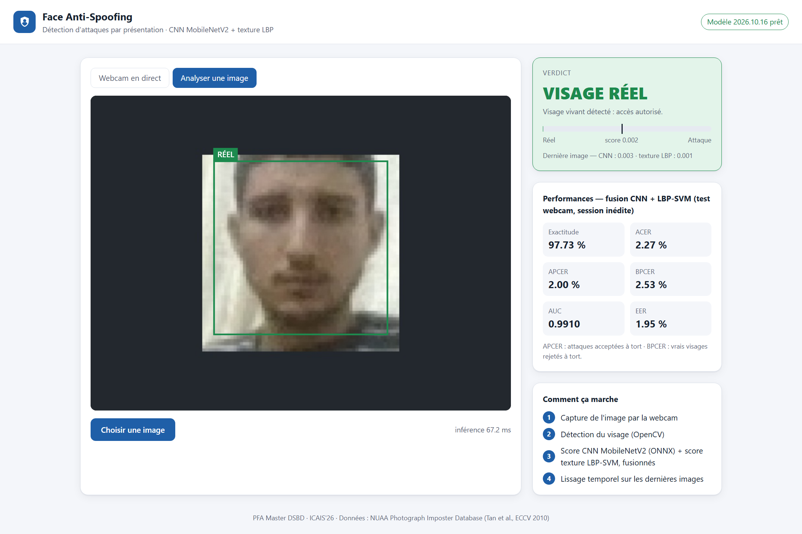

# Face Anti-Spoofing — PFA Master DSBD (ICAIS'26)

[](https://github.com/youssefelalem/face-anti-spoofing-mlops/actions/workflows/ci.yml)


> **EN —** Real-time presentation-attack detection (printed photo, phone screen) from a single
> webcam frame. A **MobileNetV2 CNN** (transfer learning) is fused with an **LBP texture + SVM**
> model, served by **FastAPI** with a live web demo, inside a reproducible **MLOps** pipeline
> (data contract, MLflow, tests, CI, ONNX, Docker). Main finding: a CNN scoring 0.9997 AUC on
> internal validation dropped to 0.80 on an unseen recording session; the data contract traced
> it to a brightness shortcut, and texture fusion made the detector far more robust.

**🔴 Live demo: <https://face-anti-spoofing.onrender.com>** (free hosting: the first visit
after inactivity takes ~1 min to wake up; frames are analysed and never stored).

<p align="center"></p>

Détection d'attaques par présentation (photo imprimée, écran) à partir d'une seule
image RGB : **CNN MobileNetV2 en transfer learning** fusionné avec un modèle de
**texture LBP + SVM**, entraînés sur **NUAA** et sur des données webcam propres,
servis par une **API FastAPI** avec une **interface webcam**, dans une chaîne
**MLOps** reproductible (data contract, MLflow, tests, CI, Docker).

```
Webcam ─► visage (OpenCV) ─┬─► MobileNetV2 (ONNX) ─► calibration ─┐
                           └─► LBP + SVM ──────────► calibration ─┴─► moyenne ─► « RÉEL » / « ATTAQUE »
```

## Résultats

Deux jeux de test **jamais vus à l'entraînement** ; seuil de décision fixé sur la
validation (métriques ISO/IEC 30107-3 : APCER = attaques acceptées, BPCER = vrais
visages rejetés, ACER = moyenne des deux).

| Test | Modèle | AUC | EER | ACER | APCER | BPCER |
|---|---|---|---|---|---|---|
| NUAA session 3 (9 123 img.) | CNN MobileNetV2 | 0.717 | 36.3 % | 36.1 % | 35.1 % | 37.1 % |
| | LBP + SVM | **0.923** | **16.0 %** | **13.5 %** | 26.9 % | 0.1 % |
| | **Fusion** | 0.860 | 28.0 % | 27.5 % | **19.9 %** | 35.0 % |
| Webcam, nouvelle personne, session s2 (308 img.) | CNN MobileNetV2 | 0.798 | 26.6 % | 42.9 % | 83.3 % | 2.5 % |
| | LBP + SVM | **1.000** | **0.0 %** | **0.0 %** | 0.0 % | 0.0 % |
| | **Fusion** | 0.991 | 1.9 % | 2.3 % | 2.0 % | 2.5 % |

Application (fusion) : **~28 ms par image** sur le CPU d'un portable (branché sur secteur),
modèle ONNX de 8,9 Mo. Source : `reports/final_metrics.json`, `reports/app_benchmark.json`.

**Constats principaux** (détail : `reports/experiments.md`, `reports/*.json`) :

1. **La validation interne est trompeuse** : le premier CNN obtenait une AUC de 0,9997 en
   validation (sessions 1-2) mais 0,80 sur la session 3. Les sessions d'entraînement
   partagent un biais (attaques imprimées pâles et claires) absent de la session 3.
2. **Le data contract détecte ce raccourci** : la luminosité seule sépare les classes du
   jeu d'entraînement (AUC 0,92), la saturation aussi (0,89).
3. **La texture (LBP) généralise mieux que le CNN** sur ces décalages de session, dans
   toutes les expériences ; la fusion améliore nettement le CNN et a le plus faible APCER
   sur NUAA.
4. **Le CNN est instable** : ajouter des données webcam d'une seule personne a amélioré
   le comportement en direct dans sa pièce, mais dégradé la généralisation à d'autres
   personnes (AUC NUAA 0,83 → 0,72).

**Limites** : les résultats du test NUAA ont été consultés pendant la conception
(estimation optimiste) — le test webcam s2 est, lui, resté indépendant ; le jeu webcam
est petit (2 personnes, pas d'impressions papier) ; pas d'attaques par masque 3D.
Chaque exécution du pipeline est archivée dans `models/saved/versions/` (registre local).

## Lancer la démo

Prérequis : Python 3.12 (ou Docker), et le modèle exporté dans `models/saved/`
(non versionné dans Git — voir « Reproduire l'entraînement »).

```powershell
.\.venv\Scripts\python.exe -m uvicorn app.main:app --port 8501
```

Puis ouvrir <http://localhost:8501>, cliquer sur **Démarrer la caméra**, et
présenter son visage, puis une photo imprimée ou affichée sur un téléphone.

Avec Docker :

```powershell
docker build -t face-antispoofing .
docker run --rm -p 8501:8000 face-antispoofing
```

### Déploiement en ligne (gratuit, Render.com)

Les modèles ne sont pas dans Git : ils sont publiés dans un dépôt Hugging Face **privé**
(`python deploy/upload_models_hf.py`) et téléchargés par l'application au démarrage.
Sur Render : *New > Blueprint*, choisir ce dépôt (`render.yaml`), puis renseigner la
variable secrète `HF_TOKEN` (jeton Hugging Face en **lecture**). ~160 Mo de RAM, compatible
avec l'offre gratuite (512 Mo).

API : `GET /health`, `GET /model`, `POST /predict` (image JPEG/PNG) — documentation
interactive sur <http://localhost:8501/docs>.

## Reproduire l'entraînement

```powershell
py -3.12 -m venv .venv
.\.venv\Scripts\python.exe -m pip install -r requirements.txt --extra-index-url https://download.pytorch.org/whl/cpu

# 1. Données : télécharger « Face-detector output » (73 Mo) depuis la page officielle NUAA,
#    puis l'extraire dans data/raw/nuaa/  (voir data_contract.yaml → source.url)
# 2. Pipeline
.\.venv\Scripts\python.exe -m src.preprocessing.build_manifest   # manifeste + splits
.\.venv\Scripts\python.exe -m src.preprocessing.validate_data    # contrôle qualité (bloquant)
.\.venv\Scripts\python.exe -m src.preprocessing.webcam_manifest  # données webcam (optionnel)
.\.venv\Scripts\python.exe -m src.train                          # CNN (MLflow)
.\.venv\Scripts\python.exe -m src.evaluate                       # test CNN + figures
.\.venv\Scripts\python.exe -m src.baseline_lbp_svm               # LBP + SVM
.\.venv\Scripts\python.exe -m src.fusion                         # calibration, fusion, comparaison
.\.venv\Scripts\python.exe -m src.export_onnx                    # modèle pour l'application
.\.venv\Scripts\python.exe -m src.benchmark                      # latence, taille
```

Ou tout d'un coup, avec arrêt au premier échec : `python -m src.pipeline`.

Collecte de données webcam propres (images locales, jamais dans Git) :

```powershell
$env:FAS_ENABLE_COLLECT='1'; .\.venv\Scripts\python.exe -m uvicorn app.main:app --port 8501
```

puis <http://localhost:8501/collect>.

Poster : `python docs/poster/make_figures.py`, `python docs/poster/build_poster.py`
(python-pptx), `python docs/poster/render_poster.py` (PDF/PNG via PowerPoint).

Comparaison des stratégies : `python -m src.experiments` → `reports/experiments.md`.
Interface MLflow : `mlflow ui --backend-store-uri sqlite:///experiments/mlflow_runs/mlflow.db`.

Tests et lint : `pytest` et `ruff check .` (exécutés aussi par GitHub Actions).

## Organisation

| Chemin | Rôle |
|---|---|
| `data_contract.yaml` | contrat de données : source, schéma, qualité, anti-fuite |
| `src/preprocessing/` | manifeste, contrôle qualité, dataset PyTorch |
| `src/models/mobilenet.py` | MobileNetV2 + nouvelle tête 2 classes |
| `src/train.py`, `src/experiments.py` | entraînement CNN, comparaison de configurations |
| `src/baseline_lbp_svm.py`, `src/fusion.py` | modèle texture, calibration et fusion |
| `app/collect.py` | page de collecte de données webcam (option `FAS_ENABLE_COLLECT=1`) |
| `src/evaluate.py` | métriques ISO/IEC 30107-3 et figures |
| `src/export_onnx.py` | export ONNX + vérification de parité + `model_meta.json` |
| `src/utils/` | prétraitement et détection de visage **partagés** entraînement / application |
| `app/` | API FastAPI + interface web |
| `tests/` | tests unitaires et d'API (modèle ONNX factice, sans données) |
| `docs/dataops_mlops_mapping.md` | correspondance cours MLOps/DataOps/DevOps → projet |
| `docs/poster/` | poster ICAIS'26 (template officiel A0) |

## Données et licence

NUAA Photograph Imposter Database — usage de recherche non commercial,
redistribution interdite : les images et les modèles entraînés **ne sont jamais
versionnés** (voir `.gitignore`). Référence : X. Tan, Y. Li, J. Liu, L. Jiang,
*Face Liveness Detection from a Single Image with Sparse Low Rank Bilinear
Discriminative Model*, ECCV 2010.
